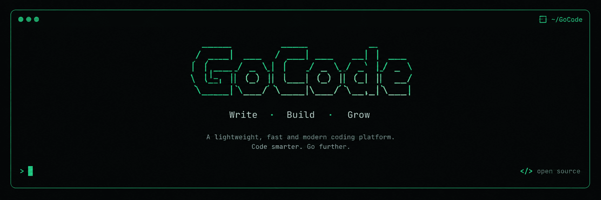

<div align="center">



# GoCode

**A native Go AI coding agent for your terminal.**

[](https://github.com/mevarx/GoCode/actions/workflows/ci.yml)
[](https://goreportcard.com/report/github.com/mevarx/GoCode)
[](https://github.com/mevarx/GoCode/releases)
[](https://opensource.org/licenses/MIT)

[Quick Start](#quick-start) •
[Features](#features) •
[Security](#security) •
[Configuration](#configuration) •
[Contributing](#contributing)

</div>

<!--
  TODO: add a real terminal demo here (GIF or video, ~20-30 seconds).
  Show: ask GoCode to inspect a project -> it proposes a patch -> approval prompt -> task runs.
  Example: <p align="center"></p>
-->

---

GoCode helps you explore, write, refactor, and debug code from your command line. Connect your preferred AI provider, use a local model, and keep control over file changes and shell commands through explicit approval.

- **Native Go CLI**: a self-contained executable with no separate Python or Node.js runtime required.
- **Your choice of models**: 22 built-in provider gateways, any OpenAI-compatible endpoint, or a local backend such as Ollama or llama.cpp.
- **Controlled execution**: review diffs and approve commands before they run, with `normal` and `yolo` permission modes.
- **A real terminal UI**: six built-in themes plus your own, sidebar layout, markdown rendering, live tool cards and tinted diffs.
- **Hooks**: run your own scripts at 13 lifecycle events with a Claude Code-compatible contract.
- **Persistent sessions**: SQLite-backed history that resumes where you left off.
- **Extensible**: add external tools through the Model Context Protocol (MCP).

---

## Quick Start

### 1. Install

```bash
npm install -g gocode-cli
```

<details>
<summary>Other install options</summary>

```bash
# One-shot, no install
npx gocode-cli
bunx gocode-cli

# Go toolchain
go install github.com/mevarx/GoCode/cmd/gocode@latest

# From source
git clone https://github.com/mevarx/GoCode.git
cd GoCode
go build -o gocode ./cmd/gocode/
```

Pre-built binaries are available on the [Releases page](https://github.com/mevarx/GoCode/releases).

Building from source uses the Go version pinned in `go.mod` (1.26.11); an older installed toolchain downloads it automatically (`GOTOOLCHAIN=auto`).

</details>

### 2. Connect a provider

**Cloud provider** (example: Gemini):

```bash
export GEMINI_API_KEY="your-key"
gocode --provider gemini
```

**Local model** (example: Ollama):

```bash
ollama serve                 # in another terminal, with a model already pulled
gocode --provider ollama
```

### 3. Start working

```bash
gocode
```

Then ask for something concrete, such as *"Find where config is loaded and explain the precedence order."* GoCode asks for confirmation before it writes files or runs commands.

### Common commands

| Command | What it does |
| :-- | :-- |
| `gocode` | Launch and resume your last session |
| `gocode --new` | Start a fresh session |
| `gocode --provider <name> --model <id>` | Pick a provider and model for this run |
| `gocode --tui=false` | Plain terminal mode, no TUI |
| `gocode --yolo` | Skip prompts for safe calls; dangerous calls are refused (deny-list still applies) |
| `gocode doctor` | Health-check configured providers |
| `gocode logs --follow` | Follow live logs |
| `gocode session export` | Export a session transcript to Markdown or JSON |
| `/provider`, `/model` | Switch provider or model in-session |
| `/sessions`, `/new`, `/clear` | List, start, or reset sessions |
| `/compact` | Summarize earlier turns to free context window |
| `/stats` | Show estimated token usage and message count |
| `/commit [message]` | Commit modified files with an `Assisted-by:` trailer |
| `/help` | Show all in-session commands |

TUI keys: `Ctrl+P` opens the command palette (`Ctrl+K` still works), `Ctrl+L` the model picker, `Ctrl+T` the theme picker, `Tab` completes slash commands, their arguments and `@file` mentions, `Alt+P`/`Alt+N` recall prompt history (saved per workspace), and the mouse wheel scrolls the transcript. `Tab`/`h`/`l` move focus between prompt, chat and sidebar; in chat, `space` expands an item and `c`/`y` copy it. `Enter` while the agent is streaming queues a steering message instead of interrupting; `Esc` stops a running turn or clears input, and `Ctrl+C` stops a turn (press again to quit).

---

## Features

### File and shell tools

| Tool | Purpose | Approval |
| :-- | :-- | :-: |
| `file_read` | Read files, with line offset and limit | Automatic |
| `code_search` | Regex or plain-text search with context and glob filters | Automatic |
| `plan` | Record a task checklist rendered into the system prompt | Automatic |
| `scratchpad` | Persist goal, decisions, and open files across compaction | Automatic |
| `file_write` | Create or overwrite files, with a unified diff preview | **Required** |
| `file_patch` | Targeted edits, with a unified diff preview | **Required** |
| `shell_exec` | Run a terminal command in the workspace directory | **Required** |

Change which tools need approval with the `[permissions]` section of `config.toml`. See [Security](#security) before auto-approving anything.

### Context that manages itself

Long sessions stay usable without manual housekeeping:

- **Automatic compaction** summarizes earlier turns before the context window fills, cutting only at turn boundaries so a tool result never separates from its call. Old tool output is elided to token-count placeholders, and a provider context-overflow error triggers compaction and one retry instead of silently dropping history. Tune it with `[context]` in `config.toml`; `/compact` still works on demand.
- **Mid-turn steering**: press `Enter` while the agent is working to queue guidance; it is applied at the next model round — no cancel needed. Prompts submitted while a turn runs are queued and run as their own turns, in order; cancelling settles everything queued.
- **Transcript repair and anchored compaction**: history is repaired so every tool call stays paired with its result, and each compaction is saved as a summary anchor — a resumed session replays exactly the compacted window.
- **Provider-reported usage**: token counts come from the provider when it reports them (opt-in `stream_usage` for OpenAI-compatible gateways), and the status line shows context usage, last-turn tokens and elapsed time.

### A terminal UI that keeps up

- Sidebar layout with a gradient logo and session/model/workspace/MCP sections; below 120×30 it folds into a compact one-row header. Chat uses a clean gutter rhythm instead of card borders.
- Assistant text renders as markdown with syntax highlighting; tool calls render as live cards (arguments stream in as the model writes them, with spinner, elapsed time and pending/running/done/error states); diffs render as tinted two-band rows.
- Six built-in themes plus user themes you can edit in-app: `Ctrl+T` previews live and saves, `Ctrl+E` opens the palette editor. See [docs/themes.md](docs/themes.md).
- Rounded dialogs with badges and toasts; the permission dialog defaults to Deny for dangerous calls and absorbs reflexive keystrokes for a moment so a prompt never eats your typing.
- One shared 50 ms clock drives every animation, including the scramble spinner; text renders on arrival by default, with opt-in smooth pacing (`smooth_streaming = true`).
- `Ctrl+P` command palette, `Tab` and `@file` completion, per-workspace prompt history, a session picker (`/sessions`) and a model picker that refreshes when opened.
- Motion is configurable (`[tui] motion = "auto" | "reduced" | "off"`), and terminal reduced-motion preferences are honored — functional indicators degrade to static glyphs, never disappear.

### Permission modes

`normal` (default) prompts before gated calls. `yolo` (`[permissions] mode = "yolo"` or `gocode --yolo`) skips prompts for non-dangerous calls and **refuses dangerous calls without asking** — a conservative classifier flags destructive shell commands and file mutations. In every mode the deny-list and secret redaction stay unconditional, and session grants (`a`) remember exact commands/arguments only.

### Hooks

Run your own scripts at 13 lifecycle events — before/after tool calls, around turns, sessions and compaction, and at permission prompts. Hooks speak a Claude Code-compatible JSON contract on stdin/stdout with exit-code semantics (0 = ok, 2 = deny, 49 = deny + halt), run in parallel with per-hook timeouts, and aggregate in config order. A hook can block a call, rewrite its input or output, add context, or halt a turn — but it can never bypass the deny-list or redaction.

```toml
[[hooks.PreToolUse]]
matcher = "^shell_exec$"
command = "echo 'shell is disabled here' >&2; exit 2"
```

Full reference: [docs/hooks.md](docs/hooks.md).

### Providers

Switch providers and models at any time with `/provider` and `/model`. GoCode ships with gateways for:

Ollama, OpenAI, Anthropic Claude, Google Gemini, GitHub Copilot, xAI, Mistral, Mistral Vibe, MiniMax, DeepSeek, Groq, OpenRouter, Together, Fireworks, Cerebras, Zhipu, NVIDIA NIM, OpenCode Go, Qwen, Kimi, Hermes Agent, and OmniRoute.

| Provider | `--provider` | API key variable |
| :-- | :-- | :-- |
| Google Gemini | `gemini` | `GEMINI_API_KEY` |
| Anthropic Claude | `anthropic` | `ANTHROPIC_API_KEY` |
| OpenAI | `openai` | `OPENAI_API_KEY` |
| GitHub Copilot | `copilot` | `GITHUB_COPILOT_TOKEN` (or `gocode auth copilot --client-id <oauth-app-id>`) |
| xAI | `xai` | `XAI_API_KEY` |
| Mistral | `mistral` | `MISTRAL_API_KEY` |
| Mistral Vibe | `mistral-vibe` | `MISTRAL_API_KEY` |
| MiniMax | `minimax` | `MINIMAX_API_KEY` |
| DeepSeek | `deepseek` | `DEEPSEEK_API_KEY` |
| Groq | `groq` | `GROQ_API_KEY` |
| OpenRouter | `openrouter` | `OPENROUTER_API_KEY` |
| Together | `together` | `TOGETHER_API_KEY` |
| Fireworks | `fireworks` | `FIREWORKS_API_KEY` |
| Cerebras | `cerebras` | `CEREBRAS_API_KEY` |
| Zhipu (GLM) | `zhipu` | `ZHIPU_API_KEY` |
| NVIDIA NIM | `nvidia` | `NVIDIA_API_KEY` |
| OpenCode Go | `opencode-go` | `OPENCODE_API_KEY` |
| Qwen (DashScope) | `qwen` | `DASHSCOPE_API_KEY` |
| Kimi (Moonshot) | `kimi` | `MOONSHOT_API_KEY` |
| Hermes Agent | `hermes` | `HERMES_API_SERVER_KEY` |
| OmniRoute | `omniroute` | none (local gateway at `127.0.0.1:20128`) |
| Ollama (local) | `ollama` | none |

Model catalogs change often. Use `/providers` to list all providers plus the active provider's current models, and `/model <id>` to select one. Availability still depends on your account, region, and plan.

**Add any OpenAI-compatible endpoint** (company gateways, llama.cpp, OpenCode Zen, and others):

```bash
gocode provider add my-gateway \
  --base-url https://gateway.internal/v1 \
  --api-key-env MY_GATEWAY_KEY \
  --model my-model

export MY_GATEWAY_KEY="your-key"
gocode --provider my-gateway
```

Only the environment-variable *name* is stored, never the key. Manage endpoints with `gocode provider list` and `gocode provider remove <name>`. Setup guides for Copilot, Hermes, llama.cpp, and OpenCode Zen are in [docs/providers.md](docs/providers.md).

### Local models

GoCode supports offline workflows when a local model and its backend (Ollama or a llama.cpp `llama-server`) are installed, running, and configured. Nothing is sent to a cloud provider unless you select one.

### Sessions

Conversations are saved to SQLite and the last session resumes automatically.

```bash
/sessions            # list saved sessions
/sessions <id>       # switch to a session (alias: /resume <id>)
/new                 # start fresh
```

In the TUI, `/sessions` opens an interactive picker (type to filter, arrows to move, Enter to resume); the plain terminal keeps the text list.

#### Exporting sessions

Export conversation transcripts from the stored SQLite history to Markdown or JSON:

```bash
# Export the latest session to stdout (Markdown)
gocode session export

# Export a specific session to a file
gocode session export <session_id> --output transcript.md

# Export as JSON without tool calls/results
gocode session export --format json --no-tools --output transcript.json

# Explicitly permit overwriting an existing destination
gocode session export --output transcript.md --force
```

- **Formats**: Markdown (`.md`, default) and JSON (`.json`).
- **Privacy**: Internal system prompts and model reasoning chains are always excluded from exports.
- **File safety**: Destination files are created with `0600` permissions on POSIX systems (owner read/write only). Existing files are never overwritten unless `--force` is provided.
- **Tools**: Tool invocations and results are included by default; pass `--no-tools` to omit them.

Sessions live at `~/.local/share/gocode/sessions/sessions.db` on Linux and macOS, and `%LOCALAPPDATA%\gocode\sessions\sessions.db` on Windows. Set `persist = false` under `[session]` to keep a conversation in memory only, with nothing written to disk.
### Project and global context

GoCode searches the current directory and its parents for `AGENTS.md`, `.gocode/AGENTS.md`, or `docs/AGENTS.md` and injects it into the system prompt as delimited untrusted repository data (`## Project Context (untrusted repository data)`), after the safety rules; this text cannot override the approval policy.

For rules that apply to every repository, create `~/.config/gocode/CONTEXT.md` (`%APPDATA%\gocode\CONTEXT.md` on Windows).

### Ignore rules: `.gocodeignore`

Keep sensitive files away from GoCode's file tools by adding a `.gocodeignore` to your repository root:

```gitignore
.env*
secrets/
*.pem
*.key
credentials.json
```

If `.gocodeignore` is missing, GoCode falls back to `.gitignore`. On case-insensitive filesystems (Windows and macOS), patterns match regardless of letter case, so `.ENV` is treated the same as `.env`. On Linux, matching stays case-sensitive.

### MCP servers

Extend GoCode with any MCP server over `stdio`:

```bash
gocode mcp add filesystem npx -y @modelcontextprotocol/server-filesystem /path/to/repo
gocode mcp list
gocode mcp remove filesystem
```

MCP tools are registered into the agent's tool catalog on startup. Everything after the server name belongs to the server, so put GoCode's own flags first:

```bash
gocode --config /path/to/config.toml mcp add filesystem npx -y @scope/server .
```

To pass `--config` to the server instead, separate the sections with `--`:

```bash
gocode mcp add filesystem npx -y @scope/server . -- --config /path/to/config.toml
```

---

## Security

GoCode is built around human-in-the-loop approval: the agent cannot write files or run commands without your confirmation unless you explicitly auto-approve a tool. `yolo` mode skips prompts for safe calls but refuses dangerous ones, and the deny-list plus secret redaction apply unconditionally in every mode — including over hook allows.

**File tools are confined.** `file_read`, `file_write`, `file_patch`, and `code_search` resolve every path through the workspace root, reject traversal, and re-check after resolving symlinks. Sensitive files (`.env*`, SSH keys, certificates, cloud credentials) and anything matched by your ignore rules are blocked.

**Credentials stay out of files.** On POSIX systems `config.toml` and `gocode.log` are created owner-only (`0600`; their directories `0700`), and a config or log file with looser permissions is tightened when it is loaded. Prefer `api_key_env` over inline `api_key`: an inline key is stored in plaintext, so `gocode doctor` prints a warning for every provider that uses one. Provider base URLs are validated at load time: HTTPS is required except for localhost/loopback, and URLs containing embedded credentials, a query, or a fragment are rejected.

**The shell is not confined.** `shell_exec` uses the workspace as its *working directory*, which is not a sandbox. A command can read anything your user account can read. Static inspection cannot reliably prevent this, since command substitution, pipes, and interpreters defeat it. GoCode instead provides:

- **Secret redaction**: tool results, tool-call arguments, and session exports are always redacted before reaching the model or your transcript — this cannot be disabled. The `[tools.shell] redact_secrets` setting controls only masking of `shell_exec` command output before it enters the tool result; setting it to `false` is not recommended.
- **Credential-free child env**: child processes (shell commands and MCP servers) do not inherit credential-shaped environment variables by default. Names matching patterns such as `*_API_KEY`, `*_TOKEN`, `*_SECRET`, `*_KEY`, and `*_CREDENTIALS` — plus every configured provider `api_key_env` — are removed. Add more names or patterns with `[tools.shell] env_scrub`. Essential variables (`PATH`, `HOME`, `SystemRoot`, `TEMP`, …) always survive so commands still run.
- **Advisory warnings**: commands referencing known-sensitive paths are flagged in the approval prompt.
- **The approval gate**: your real protection. Read each command before approving it. Answers are `y` (once), `a` (allow these exact arguments for the rest of the session; identical calls then run without prompting and are marked `(session grant)`), `r` (allow tools that declare themselves read-only for the current turn), `e` (edit the arguments before deciding; plain terminal only), and `n` (deny). Grants are in-memory, die with the process, and never widen to different arguments — those prompt again.

**Recommendations**

- Keep `shell_exec` out of `auto_approve`, especially on machines that hold credentials.
- For a hard boundary, deny the shell entirely:

  ```toml
  [permissions]
  deny = ["shell_exec"]
  ```

- Run GoCode in a container or VM if you need real isolation.

Details and the full threat model: [docs/SECURITY.md](docs/SECURITY.md).

---

## Configuration

Config file location:

- **Linux / macOS**: `~/.config/gocode/config.toml`
- **Windows**: `%APPDATA%\gocode\config.toml`

A minimal example:

```toml
[provider]
default = "gemini"
# stream_usage = true       # ask OpenAI-compatible gateways for token usage

[provider.gemini]
api_key_env = "GEMINI_API_KEY"   # preferred: the key stays in the environment, not in this file
default_model = "gemini-3.8-flash"

[permissions]
mode = "normal"                              # normal | yolo (or gocode --yolo)
auto_approve = ["file_read", "code_search"]  # run without confirmation
deny = []                                    # permanently blocked
sensitive_patterns = ["*.vault"]             # extra patterns hidden from the AI

[session]
persist = true

[context]
auto_compact = true         # summarize earlier turns before the window fills
keep_recent_tokens = 20000  # verbatim tail automatic compaction keeps

[tui]
motion = "auto"             # auto | reduced | off (decorative motion)
smooth_streaming = false    # opt-in pacing; default renders text on arrival
active_theme = "gocode-dark"  # six built-ins + user themes; Ctrl+T to pick
transparent = false         # true: let the terminal background show through

[tools]
max_tool_iterations = 50      # provider round-trips per turn
max_repeated_tool_calls = 3   # identical tool calls per turn

[tools.shell]
timeout_seconds = 30
max_output_bytes = 1048576
redact_secrets = true         # mask shell_exec output; transcript/export redaction is always on
# Extra env var names or glob patterns to remove from child processes,
# on top of the built-in credential patterns.
env_scrub = ["MY_GATEWAY_KEY", "TEAM_*_CREDENTIALS"]
```

Only the sections you change need to appear; everything else comes from defaults. The full reference — every config key and CLI flag, MCP servers, custom providers, hooks and Copilot settings — is in [docs/configuration.md](docs/configuration.md). Themes: [docs/themes.md](docs/themes.md). Hooks: [docs/hooks.md](docs/hooks.md).

---

## Platform support

Release builds are configured with GoReleaser for Linux, macOS, and Windows on AMD64 and ARM64. See the [CI workflow](https://github.com/mevarx/GoCode/actions) for current build and test status.

---

## Project layout

```
cmd/gocode/        CLI entry point, flags, subcommands
internal/agent/    agent loop, dispatch, context management, slash commands
internal/config/   platform directories, strict TOML parsing
internal/hooks/    hook engine (13 events, Claude Code-compatible contract)
internal/pubsub/   in-process event bus (lossy / must-deliver / coalescing)
internal/provider/ provider registry (Ollama, OpenAI-compatible, Anthropic)
internal/tools/    tool registry, shell execution, patch engine, approval gates
internal/session/  SQLite session persistence
internal/mcp/      MCP stdio client
internal/ignore/   .gocodeignore / .gitignore matching
internal/safetext/ terminal text sanitization
internal/eval/     deterministic eval suite (make eval)
internal/version/  build version metadata
internal/tui/      Bubble Tea interface (render cache, overlays, animation)
```

A deeper walkthrough is in [docs/architecture.md](docs/architecture.md).

---

## FAQ

**Can I use GoCode without a cloud provider?**
Yes. Configure Ollama or a llama.cpp server and select it with `--provider`. See [Local models](#local-models).

**Is it free?**
GoCode is MIT-licensed and free. Cloud providers bill you under their own terms; local models have no API cost.

**How do I add tools?**
Through MCP: `gocode mcp add <name> <command> [args...]`. See [MCP servers](#mcp-servers).

**Where are my sessions?**
See [Sessions](#sessions). Use `gocode --new` or `/new` to start fresh.

---

## Contributing

Contributions are welcome. Please read [CONTRIBUTING.md](CONTRIBUTING.md) for the code of conduct and pull request process. Release history is in [CHANGES.md](CHANGES.md).

```bash
go build ./...
go vet ./...
go test ./...
```

## License

MIT. See [LICENSE](LICENSE).

---

<div align="center">

Built with [Bubble Tea](https://github.com/charmbracelet/bubbletea) v2 • Made by [mevarx](https://github.com/mevarx)

</div>
